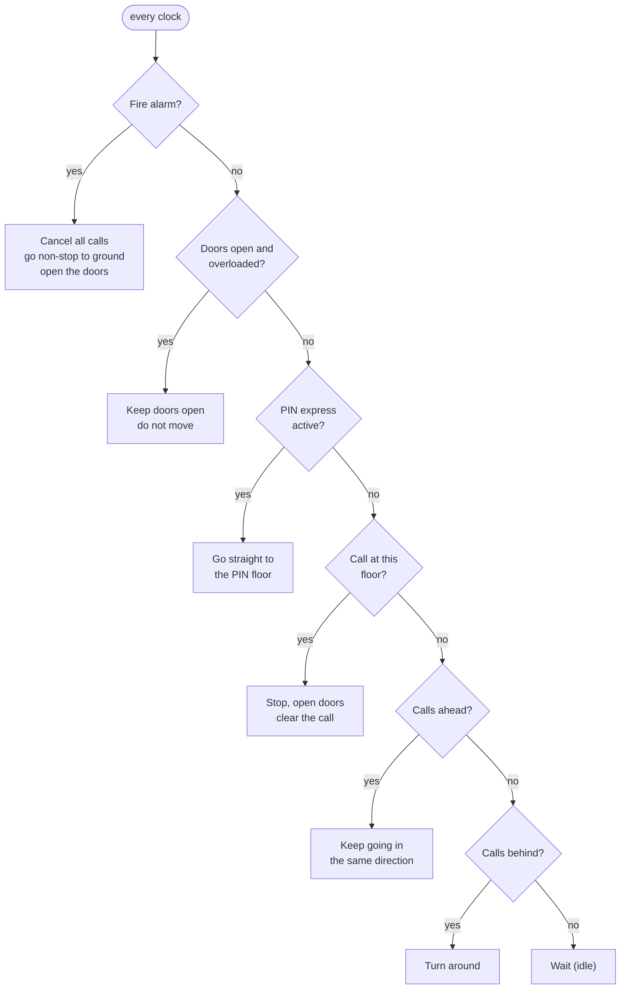
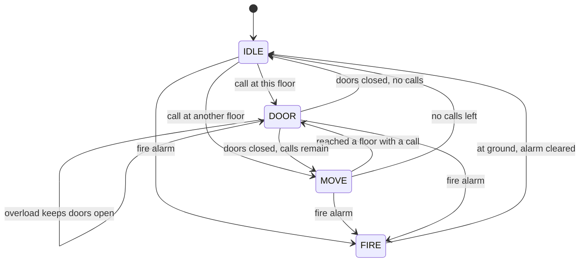

# Smart Lift Controller (Verilog, Intel MAX 10 FPGA)

[](https://github.com/Krithik-Bala/secure-elevator-controller-fpga/actions/workflows/sim.yml)

A controller for a lift in a 4-floor building (ground + 3 floors), written in Verilog. It started as a Digital Systems Design lab project implemented on an Intel MAX 10 FPGA, and was then extended into a controller that behaves like a real building lift.

## What it does, in plain words

- **Remembers every button press**: the call button outside each floor and the floor buttons inside the lift.
- **Serves them the way real lifts do**: the lift keeps going in one direction and stops at every floor where someone is waiting or wants to get off. It turns around only when nobody is left ahead, and waits when there are no calls at all.
- **Fire alarm**: cancels every call, goes straight to the ground floor without stopping, opens the doors and ignores all buttons until the alarm is cleared.
- **Overload**: the doors stay open and the lift will not leave until the extra load steps out.
- **PIN express**: an authorised user (for example a hospital stretcher or maintenance staff) enters a PIN and the lift goes straight to their floor. Calls it skips are not lost; they are served right after.

### Priority, and why in this order

| # | Input | Why it wins |
|---|---|---|
| 1 | Fire alarm | Life safety comes first, over everything, including authorised users |
| 2 | Overload | Moving an overloaded lift is unsafe, so even an express trip waits |
| 3 | PIN express | Priority service, but never at the cost of safety |
| 4 | Normal calls | Everyday service |

### Example

The lift is at the ground floor. Someone on floor 3 calls it. While it passes floor 1, someone on floor 2 calls too. The lift **stops at floor 2 on the way**, then continues to floor 3, instead of going to 3 first and coming back.

## Where these behaviours come from in real lifts

- **Collective control** (stop for every call in the direction of travel) is how ordinary building lifts are scheduled. The same idea is used to schedule disk-head movement, where it is called the *elevator* or *SCAN* algorithm.
- **Fire recall** (go to the main floor and open the doors) is a standard lift safety function, defined for example in EN 81-73.
- **Overload hold** with doors open is standard on passenger lifts.
- **Priority / independent service** with a key or code is used in hospitals and hotels.

## How it decides





**How the request memory works:** `pending` has one bit per floor. A button press sets its floor's bit; the bit clears when the lift stops at that floor and opens its doors. The lift compares `pending` with the floors above and below its position to decide whether to keep going, turn around or wait. This is the same set-on-event, clear-when-served pattern used for interrupt pending bits in microcontrollers.

## Interface (`rtl/lift_ctrl.v`)

| Signal | Dir | Meaning |
|---|---|---|
| `clk`, `rst_n` | in | Clock; active-low reset (lift at ground floor, idle) |
| `tick` | in | Timing pulse from a clock divider: one tick = travel time for one floor |
| `floor_call[3:0]` | in | Call button outside the lift on each floor |
| `cabin_call[3:0]` | in | Floor buttons inside the lift |
| `pin_ok` | in | Correct PIN entered on the cabin keypad |
| `overload` | in | Load sensor |
| `fire` | in | Fire alarm |
| `cur_floor[1:0]` | out | Current floor (0 = ground) |
| `dir_up`, `moving`, `door_open` | out | Direction, travelling, doors open |
| `pending[3:0]` | out | Remembered calls (for indicator lights) |
| `express` | out | PIN express trip in progress |

Parameter `DOOR_TICKS` sets how long the doors stay open.

## Verification

`tb/tb_lift_ctrl.v` is self-checking. It logs the floor every time the doors open and checks the exact order in which floors were served:

| Scenario | Expected |
|---|---|
| Floor 3 calls; floor 2 calls while the lift passes floor 1 | Stops at 2 on the way, then 3 |
| Going down to 0; calls at 1 (ahead) and 3 (behind) | Serves 1, then 0, then turns around for 3 |
| Calls waiting at 2 and 1; PIN user goes to 0 | Non-stop to 0, then serves 1 and 2 |
| Overload with a PIN trip pending | Doors held open, lift stays; continues once load is removed |
| Fire alarm during a PIN trip | Non-stop to ground, doors open, all calls cancelled and new presses ignored |

GitHub Actions runs every testbench on each push (badge above).

```bash
iverilog -g2012 -o lift.vvp rtl/lift_ctrl.v tb/tb_lift_ctrl.v && vvp lift.vvp
```

ModelSim / Questa: `vlog rtl/lift_ctrl.v tb/tb_lift_ctrl.v` then `vsim -c tb_lift_ctrl -do "run -all; quit"`.

## The lab version (2024)

`lab/el.v` is the design as submitted for the Digital Systems Design lab (BECE102P, VIT), implemented on an Intel MAX 10 `10M50DAF484C7G` (Terasic DE10-Lite) through Quartus Prime, programmed over JTAG with a USB-Blaster and tested with the board's switches and LEDs. Team: Krithik B, Kabilan S, Shenbaga Swedha P, Barani M S.

It handled one request at a time with the priority overload, then PIN, then fire alarm. Reviewing it led to the current controller:

| Lab version | Current controller |
|---|---|
| One request at a time | Remembers every call and serves them in travel order |
| PIN had priority over the fire alarm | Fire alarm first, then overload, then PIN |
| No reset | Reset to the ground floor |
| Blocking and non-blocking assignments mixed | Non-blocking only in sequential logic |
| Express and fire moved several floors in one clock | One floor per travel-time tick; doors open for a set time |

`lab/tb_el.v` tests the lab version as it was built. The current controller is verified in simulation; the FPGA demo was done with the lab version.

## Possible extensions

- Separate Up and Down call buttons on middle floors (the lift then stops only for people going its way).
- Door-obstruction sensor and floor-position sensors instead of a travel timer.
- Board build: clock divider for `tick`, synchronisers and debouncers on the switches, seven-segment floor display.
