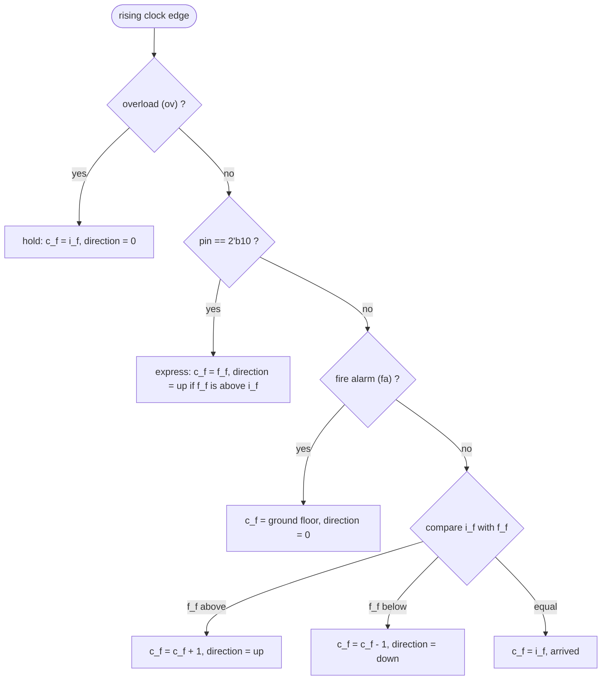
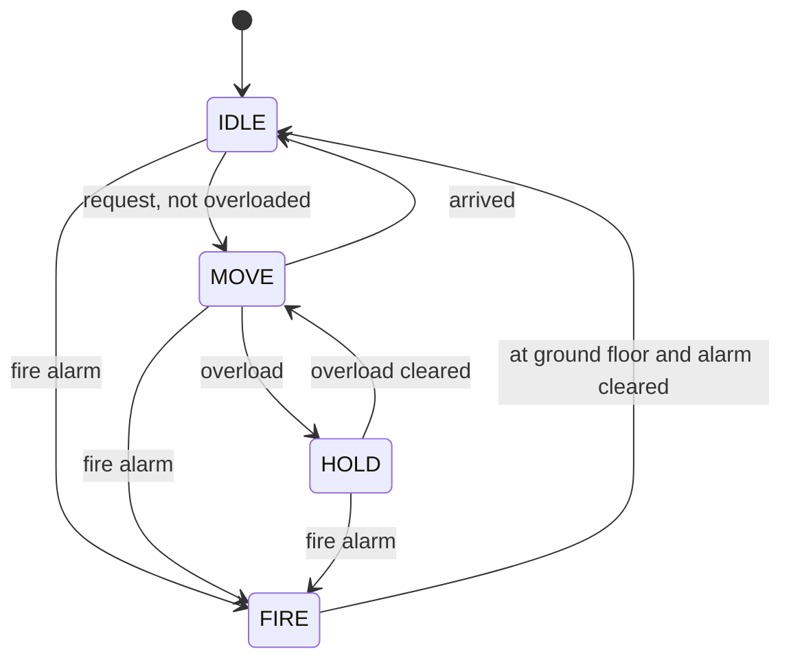

# Secure Elevator Controller (Verilog, Intel MAX 10 FPGA)

[](https://github.com/Krithik-Bala/secure-elevator-controller-fpga/actions/workflows/sim.yml)

A 4-floor elevator controller in Verilog HDL, implemented on an **Intel MAX 10 FPGA** (Terasic DE10-Lite board). On top of normal floor-by-floor travel it adds safety and access-control logic:

- **Overload hold:** the car does not move while the overload sensor is active.
- **PIN-authorised express travel:** with the correct 2-bit PIN the car goes straight to the requested floor.
- **Fire-alarm return:** the car returns to the ground floor.
- **Normal travel:** one floor per clock towards the requested floor, with an up/down direction output.

Digital Systems Design Lab (BECE102P), Vellore Institute of Technology, 2024.
Team: Krithik B, Kabilan S, Shenbaga Swedha P, Barani M S.

## Repository layout

| Path | Contents |
|---|---|
| `rtl/el.v` | Original lab design, as submitted |
| `tb/tb_el.v` | Self-checking testbench for the original design |
| `v2/elevator_fsm.v` | Reworked design (explicit Moore FSM), written after the lab |
| `v2/tb_elevator_fsm.v` | Self-checking testbench for the rework |
| `.github/workflows/sim.yml` | CI: runs both testbenches with Icarus Verilog on every push |

## Interface (original design)

| Signal | Width | Direction | Meaning | On the DE10-Lite |
|---|---|---|---|---|
| `clk` | 1 | in | Each rising edge is one step of travel | clock input |
| `i_f` | 2 | in | Present floor (floor sensor), `00` = ground ... `11` = 3rd | slide switches |
| `f_f` | 2 | in | Requested (final) floor | slide switches |
| `ov` | 1 | in | Overload sensor | slide switch |
| `fa` | 1 | in | Fire alarm | slide switch |
| `pin` | 2 | in | Access PIN (`2'b10` is the correct code) | slide switches |
| `c_f` | 2 | out | Current floor of the car | LEDs |
| `direction` | 1 | out | `1` = moving up, `0` = down or stopped | LED |

## How it decides (every rising clock edge)

The `if / else if` chain is a fixed priority: the first true condition wins.



## Hardware implementation

- **Device:** Intel MAX 10 `10M50DAF484C7G` on a Terasic DE10-Lite
- **Flow (Quartus Prime):** Analysis & Synthesis, pin assignment (slide switches for inputs, LEDs for outputs), Fitter, Assembler (`.sof`), Programmer over JTAG with the USB-Blaster, then tested on the board with switches and LEDs.

## Simulate

With [Icarus Verilog](https://steveicarus.github.io/iverilog/):

```bash
iverilog -g2012 -o el.vvp rtl/el.v tb/tb_el.v && vvp el.vvp
iverilog -g2012 -o fsm.vvp v2/elevator_fsm.v v2/tb_elevator_fsm.v && vvp fsm.vvp
```

With ModelSim / Questa:

```bash
vlog rtl/el.v tb/tb_el.v
vsim -c tb_el -do "run -all; quit"
```

Each testbench prints `PASS` / `FAIL` per check and ends with `ALL TESTS PASSED`.

## Review of the lab design, and the v2 rework

Looking back at the lab version with a reviewer's eye:

| Observation in `rtl/el.v` | Improvement in `v2/elevator_fsm.v` |
|---|---|
| Blocking (`=`) and non-blocking (`<=`) assignments mixed in one clocked block | Non-blocking only in sequential logic |
| Normal mode compares the `i_f` input with `f_f` but steps the `c_f` register, so `i_f` must be fed back from a floor sensor (the testbench does this) | The FSM compares its own `cur_floor` register with the target |
| No reset (the car's floor is unknown at power-up) | Active-low reset to the ground floor |
| The PIN has priority over the fire alarm | Fire alarm and overload override everything, including authorised users |
| Express and fire alarm move the car several floors in one clock | One floor per travel-time `tick`; authorised users get a faster `fast_tick` |
| 2-bit PIN read directly from switches | (out of scope here) longer code, lockout after failed attempts |



For a board build of v2, `tick` / `fast_tick` come from a clock divider on the 50 MHz board clock, and the switch and button inputs must be synchronised and debounced before they reach the FSM; those blocks are not included here.
